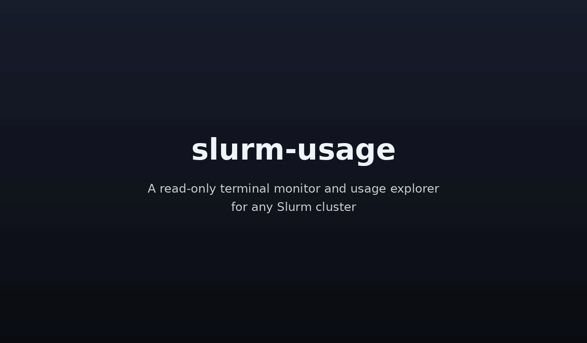

# slurm-usage

A read-only terminal monitor and usage explorer for any Slurm cluster.



([MP4 version](docs/media/demo.mp4). Everything in it is invented: see
[Try it without a cluster](#try-it-without-a-cluster).)

`slurm-usage` shows what the cluster is doing right now (nodes, GPUs, the queue,
who is running what) and how it has been used over the last day, week, month,
year or all of accounting history, by account, person, QOS, partition and kind
of run. It is a single Python package with no dependencies beyond the standard
library, it runs as an ordinary user, and nothing it does can change anything in
Slurm.

```
orion Ovw Me Nodes Queue Ppl Roles Time │ week · 53s ago
▌Cluster now · orion ──────────────────────────────────────────────────────────── 1/5
›GPU  20 total  14 alloc  2 free  4 unavail  █████████████████████          70%
 CPU  384 total  184 alloc  104 free  96 unavail  ██████████████▍                48%
 Nodes 4 (3 schedulable)  0 down  0 drain  0 completing
 Free largest block 2 GPUs on gpu-a01  stranded GPUs 0
 Queue 4 running  12 pending: JobArrayTaskLimit 10 · Resources 2
 Trend ─────────────────────── 1/5  util = alloc ÷ live capacity · GPU util* = peak sample·coverage
 Range GPU-h alloc  util CPU-h alloc  util GPU util*   CPU eff   ΔGPU   ΔCPU                trend
 day           283   59%        2268   25%       41%       63%  +682%  +658% ▄   ▁▁▁▁▂▁▁▁▁▁▃▄▄▄▄█
 week         1568   47%       12.7k   20%       38%       58%  +138%  +138% ▂▃▅█▃▂▁▁▃▂▁▃▂▁▂▂▁ ▂▁▁▆
 month        3883   27%       31.3k   11%       36%       55%   +50%   +50% ▂▃▅▂▃▃▂▁▂▅█▁▄▃▄▂▂█▇▅▃▆
 year         6477    4%       52.1k    2%       36%       55%    new    new                  ▆▆█
 all          6477   34%       52.1k   14%       36%       55%    n/a    n/a █▇█▆▂▂▃▄▃▂▂▁▄▆▃▂▃▃▆▆▄▄
 Accounts · week ─────────────────────────────────────────────────────────── 1/3  hours allocated
 Account              members  run  pend  GPUs       cap   GPU-h  share GPU util*    trend visible
 physics                    2    3     0    14     12/16     420  26.8%       44% ▄▁▁▂▁ ▁█ full
 visiting                   1    0     1     0         —     651  41.5%       31% ▄█▁▁▂▁ ▁ full
 biolab                     2    1    11     0         —     497  31.7%       40% ▂█▂▆▄▅▃▁ full
↵ open · esc back · tab pane · / filter · s sort · [ ] range · r refresh · ? help · q quit
```

Every screen in this README is made from invented data (the cluster `orion`,
the people `alice`, `bob`, `carol`, `dmitri`, `erin`, the accounts `physics`,
`biolab`, `visiting`). The test suite renders the same invented cluster.

## Install

Python 3.8 or newer on a machine where the Slurm client commands (`squeue`,
`scontrol`, `sacct`, ...) work for you, typically a login node. Nothing needs root.

```sh
# uv (recommended): an isolated tool install, `slurm-usage` on your PATH
uv tool install git+https://github.com/RyanKim17920/slurm-usage

# pipx
pipx install git+https://github.com/RyanKim17920/slurm-usage

# pip, into an environment of your choice
python3 -m pip install --user git+https://github.com/RyanKim17920/slurm-usage

# one file, no install: build a zipapp and copy it anywhere
git clone https://github.com/RyanKim17920/slurm-usage && cd slurm-usage
python3 scripts/build_zipapp.py            # writes dist/slurm-usage.pyz
python3 dist/slurm-usage.pyz --version
```

Upgrade with `uv tool upgrade slurm-usage` (or `pipx upgrade slurm-usage`);
remove with `uv tool uninstall slurm-usage`.

## Quick start

```sh
slurm-usage                      # the full-screen explorer
slurm-usage --range month        # start on another range: day, week, month, year, all
slurm-usage --user alice         # open on one person's page
slurm-usage --account physics    # open on one account's people
slurm-usage --once               # plain-text summary and exit (the default when not a terminal)
slurm-usage --json               # the same summary as JSON, for scripts
slurm-usage --history recent     # load only the chosen range and shorter ones
slurm-usage --history off        # live view only; never queries accounting
slurm-usage --anonymize          # pseudonyms everywhere, for demos and screenshots
```

That is every option, plus `--version`. The rest is chosen for you and can be
switched in the app without a restart (`O` lists every setting):

| Setting | At start | In the app |
| --- | --- | --- |
| colors | on, unless `NO_COLOR` is set or `TERM=dumb` | `C` |
| Unicode or ASCII glyphs | ASCII when the terminal's encoding cannot show the charts, or on a legacy `TERM` (vt100, ...) | `U` |
| history | `--history full` (default), `recent` or `off` | `H` cycles them |
| anonymize | `--anonymize` | `A` |
| history cache | `$SLURM_USAGE_CACHE`, else `$XDG_CACHE_HOME/slurm-usage/` | `O` shows it; `X` there clears it (asks first) |

`--once` picks ASCII by itself the same way, and `--json` is always plain ASCII.
The removed options `--no-history`, `--no-full-history`, `--no-color`,
`--ascii` and `--cache-dir` stop with a message naming their replacement.

The first start reads the current range from accounting and then fills in the
longer ranges in the background, newest first, up to all of history; the header
shows progress and partial figures (hours, utilization, job counts) are marked
`≥`. Later starts read only what changed. `--once` loads only the range it
prints.

`--once` prints the same figures without a terminal UI:

```
orion · range week · 2026-01-14 09:30
GPU   20 total  14 alloc  0 completing  2 free  4 unavailable  0 reserved
CPU   384 total  184 alloc  0 completing  104 free  96 unavailable  0 reserved
Nodes 4 (3 schedulable)  0 down  0 drain  0 completing jobs  stranded GPUs 0  largest free block 2 GPUs on gpu-a01
Queue 4 running  12 pending: JobArrayTaskLimit 10 · Resources 2

Range   GPU-h alloc   util  CPU-h alloc   util GPU util*   CPU eff    ΔGPU  trend
day             283    59%         2268    25%         ?         ?   +682%  ▄▁▁▁▂▁▁▃▄▄█
week           1568    47%        12.7k    20%         ?         ?   +138%  ▂▃▅█▃▂▁▃▂▁▂▆
month          3883    27%        31.3k    11%         ?         ?    +50%  ▂▃▅▂▃▂▅█▄▃▂█▇▅
year           6477     4%        52.1k     2%         ?         ?     new  ▆▆█
all            6477    34%        52.1k    14%         ?         ?     n/a  █▇█▆▂▃▄▃▂▁▄▆▃▆▄
util = allocated hours ÷ (live capacity × window); ≥ = window only partly loaded; ? = not loaded, or measured over under 5%; GPU util* = peak sampled per-GPU utilization·the share of allocated hours measured

Account              members   run  pend   GPUs     GPU-h   share  GPU util*  visible
visiting                   1     0     1      0       651   41.5%          ?  full
biolab                     2     1    11      0       497   31.7%          ?  full
physics                    2     3     0     14       420   26.8%          ?  full
warning: gres/gpu capacity differs: nodes have 20, the accounting database records 24; live totals use the nodes
```

## Try it without a cluster

```sh
git clone https://github.com/RyanKim17920/slurm-usage && cd slurm-usage
python3 scripts/demo/run_demo.py            # the explorer, as "alice" on the cluster "orion"
python3 scripts/demo/run_demo.py --once     # any option works
```

`scripts/demo/` holds fake `squeue`, `scontrol`, `sacct`, `sacctmgr`, `sstat`,
`sinfo`, `sprio`, `sshare` and `sreport` commands that answer from a small
deterministic simulation of an invented cluster: eight GPU nodes and two CPU
nodes (one drained), ten people in five accounts, and four months of history
with daily cycles, a 32-GPU run that preempted the low-priority queue, a
multi-node run requeued after a node failure, a failure burst and an account
that appears three weeks ago. Times follow the clock, so it always looks
current. `run_demo.py` puts only those fakes on `PATH` (a real cluster is never
asked, even on a login node) and keeps the history cache in a temporary
directory (set `SLURM_USAGE_CACHE` to a private directory to keep it between
runs); the first start loads the four months in well under a minute.

The video above is recorded from it with `scripts/demo/record.py` (needs tmux,
Pillow, pyte and imageio-ffmpeg).

## Screens

The tabs across the top are always one key away. `Enter` drills into the row
under the cursor, `Esc` goes back up the breadcrumb.

| Key | Screen | What it shows |
| --- | --- | --- |
| `o` | Overview | GPUs, CPUs, nodes and the queue now; usage per range against the previous equal period, with trend sparklines; accounts; warnings |
| `m` | Me | your own page: trend per range, what is running now, kinds of runs, events, roles, daily activity, your jobs |
| `n` | Nodes | every node: state, partitions, CPUs, memory and GPUs in use, load, drain reason |
| `j` | Queue | running and pending jobs with resources, time and the pending reason |
| `p` | People | usage per person in the range, with running and pending counts |
| `a` | Roles | usage by account, QOS or partition (`g` switches), with limits |
| `t` | Timeline | GPU (or, with `c`, CPU) usage over the range in lanes by user, account, QOS or partition |
| `?` | Help | keys, colors, placeholders and a glossary |

Drilling down: an account leads to its people, a person to their page, a node
to its jobs, and any job to **Job detail**: request, timing, every attempt with
its steps (CPU, memory and GPU use when Slurm sampled them), and where its
working directory and logs are. Jobs lists load 500 rows at a time as you
scroll (the pane header then says `N of M`), and filtering one searches all of
the loaded history, not only the rows on screen.

```
▌Job 103 · eval_ckpt ───────────────────────────────────────────────────────── 1/8
 who       bob  account physics  qos normal  partition gpu
 state     RUNNING
 request   96 CPUs  8 GPUs  768G mem  limit 1d00h
 nodes     gpu-a02
 timing    submit 04:05  start 04:10  end n/a
           waited 5m00s  elapsed 2h00m  limit used 8%
 Steps ──────────────────────────────────────────── 1/1  GPU util* = % per allocated GPU
 Step       name             state       elapsed tasks CPU eff  max RSS GPU util*  GPU mem
 0          python           RUNNING      20m00s     4     31%      12G       88%      n/a
 Logs ──────────────────────────────────────────────────────────────────────────── 1/4
 workdir /home/bob/project  [exists]
 stdout  /home/bob/project/out-103.log  [exists · being written]
 paths as Slurm recorded them; checked with os.stat, never read
 keys    l/e stdout/stderr tail · b batch script · u submit line (on request)
```

### Keys

| Keys | Action |
| --- | --- |
| `o m n j p a t` | Overview, Me, Nodes, Queue, People, Roles, Timeline |
| `←` `→` | previous / next tab (in Timeline: move the bin cursor) |
| `↑` `↓` `PgUp` `PgDn` `Home` `End` | move in the focused pane |
| `Tab` `Shift-Tab` | next / previous pane |
| `Enter`, `Esc` / `Backspace` | drill in, back out |
| `/` | filter the focused pane as you type; `Ctrl-U` clears it; in a jobs list it searches all loaded history |
| `s` `S` | cycle the sort column, reverse the sort |
| `[` `]` or `1`-`5` | range: day, week, month, year, all (shared by every screen) |
| `g` | Roles: account / QOS / partition. Me and person pages: group runs by GPUs, nodes, job name, account, QOS, partition, outcome. Timeline: lanes by user / account / QOS / partition |
| `+` `-` `,` `.` `c` | Timeline zoom and pan; `c` switches GPU / CPU lanes |
| `l` `e` `b` `u` | Job detail: stdout tail, stderr tail, batch script, submit line (fetched only on that keypress) |
| `E` | load efficiency (step usage) for the current range and person |
| `r` | refresh now |
| `A` | anonymize on / off (pseudonyms at once; open paths, scripts and logs are closed) |
| `C` | colors on / off |
| `U` | Unicode or ASCII glyphs |
| `H` | history: full, recent (the chosen range and shorter), off (live view only; stops loading) |
| `O` | settings: every switch and its state, the cache location, clear the cache |
| `?` | help |
| `q` | quit |

The mouse works too: the wheel scrolls, a click selects, a double click opens.

## What it reads

Everything comes from the Slurm client commands, run as you, through a runner
that only starts allowlisted, read-only command lines (no `scancel`, `scontrol
update`, `sacctmgr add`, ...). The full list with arguments is in
[docs/data-sources.md](docs/data-sources.md). In short:

| Source | Commands | Used for |
| --- | --- | --- |
| live state | `scontrol show node/job/partition/reservation/config/assoc_mgr`, `squeue`, `scontrol ping` | nodes, GPUs, the queue, limits |
| accounting tables | `sacctmgr show assoc/qos/user/account/cluster` | accounts, QOS, coordinators, capacity recorded in the database |
| history | `sacct -a -D -X -P` with a fixed numeric field list, in time slices | usage per range, people, roles, timeline |
| efficiency | `sacct` step usage (`TotalCPU`, `TRESUsageInTot`), only after `E` | CPU, memory and GPU efficiency |
| running steps | `sstat` for one running job, when its detail is open | live step usage |
| one job, on request | `sacct -j ID --batch-script`, `sacct -j ID -o SubmitLine`, the log file's tail | `b`, `u`, `l`, `e` in Job detail |

## Permissions

- **Read-only by construction.** Every subprocess goes through one runner that
  checks the full argument list against an allowlist of query commands and
  options before it starts. There is no code path that modifies Slurm.
- **It shows whatever your Slurm permissions allow, and nothing more.** It never
  checks ownership itself and never elevates. If the cluster sets `PrivateData`,
  you see what `squeue` and `sacct` show you; refusals appear as `denied`, and
  each account says how much of its history is `visible` to you. Operators and
  administrators see more because Slurm shows them more.
- **Job environments are never queried.**
- **Scripts, submit lines and log tails are fetched only on a keypress**, for one
  job, and are never cached or written anywhere. Bulk history never asks for
  submit lines, comments or working directories.
- Text that other users control (job names, paths, reasons, scripts, log lines)
  is sanitized before it reaches your terminal, so it cannot inject escape
  sequences.
- Log tails are read with your own file permissions, regular files only, and a
  job owner cannot make the tool show you your own private files.
- A batch script shows as `not stored` when Slurm answered but keeps no copy (an
  `srun`/`salloc` job, or a cluster without `AccountingStoreFlags=job_script`),
  and as `denied` when Slurm returned no record to you (scripts are normally
  shown only to the job's owner and to Slurm operators).

## Read the numbers carefully

- **Allocated, not used.** GPU-hours and CPU-hours are what jobs held
  (resources × wall time), whether or not they used them. Utilization (`util`)
  is allocated hours ÷ (today's live capacity × window length).
- **GPU util is a peak sample, with coverage.** `GPU util*` comes from Slurm's
  `gres/gpuutil` step samples, which are periodic peaks and may be summed over
  GPUs and tasks; values are capped per GPU. `·cov` says what share of the
  allocated hours the figure describes; below 5% coverage the figure is shown as
  `?` (too little was measured), and unsampled is `?` too, never 0. `--once`
  prints both as `value·coverage`.
- **Fail means failed, node_fail or timeout.** The `fail` column counts those
  outcomes among attempts that ended; cancelled and preempted attempts are not
  failures.
- **Steps' `GPU util*`** in Job detail is a percentage per allocated GPU.
- **Members and active.** The Overview's `members` are users with an
  association or usage in the account; Roles' `active` are users with jobs now
  or usage in the range. When you drill into an account, QOS, partition or
  person, `share` becomes `of acct` / `of QOS` / `of part` / `of user`: the part
  of that one's GPU-hours, not of the cluster's.
- **Log paths in Job detail** say `exists`, `missing`, `being written` (a
  running job's log changing, as expected) or `changed after the job ended`.
- **Preempted is not wasted.** A preempted attempt held its resources and they
  count as allocated; it is not counted as a failure.
- **Capacity can disagree.** The accounting database records its own cluster
  capacity, which can lag behind the nodes (hardware added or removed). Live
  figures use the nodes; a warning says when the two differ.
- **Requeues and preemptions are separate attempts.** History reads `sacct -D`
  so every attempt of a requeued job is counted; one job can have several.
- **Ranges are rolling** (the last 24 hours, 7 days, 30 days, 365 days) and
  compared with the equal period before, only once that period is fully
  loaded. Records ("record day", "longest ever", "first use of a QOS") are
  judged only against fully loaded earlier history; otherwise the events list
  says no earlier history is loaded.
- **Utilization uses one rule for every range:** allocated hours ÷ (today's
  capacity × the time since the later of the range start and when accounting
  began), so a range and a longer one are comparable.

## Cache and load on slurmdbd

History is cached per user in SQLite, in an owner-only directory, one file per
cluster and identity:

- `$SLURM_USAGE_CACHE` if set;
- otherwise `$XDG_CACHE_HOME/slurm-usage/`, or `~/.cache/slurm-usage/` when
  `XDG_CACHE_HOME` is not set;
- except that when `XDG_CACHE_HOME` is not set and `~/.cache` is on a network
  filesystem (NFS, Lustre, GPFS, ...), it uses node-local
  `/var/tmp/slurm-usage-<uid>` (mode 700), but only when `/var/tmp` is a local,
  root-owned, sticky directory; otherwise it stays in `~/.cache/slurm-usage/`.

The settings box (`O`) shows which one is in use. The cache holds numeric
accounting fields, names and roles, never scripts, submit lines, paths or
comments. It is disposable: clear it from the settings box (`O`, then `X`,
which asks first), or delete the directory `O` shows, for example

```sh
rm -rf "${XDG_CACHE_HOME:-$HOME/.cache}/slurm-usage" /var/tmp/slurm-usage-"$(id -u)"
```

The tool never changes the permissions of a directory that already exists: it
uses the directory if it is already private to you, and otherwise a
`slurm-usage` subdirectory it creates with mode 700. If neither is possible, or
SQLite is unavailable, history is kept in memory for that run only, and then
only up to a month is loaded in the background (longer ranges load when you
pick them); a note says so.

Keeping the load on slurmdbd low:

- history is read once, newest first, one `sacct` at a time, in time windows
  sized from how busy the cluster was in the last one, aiming at about 30,000
  rows each; a `sacct` that grows past 512 MB anyway is stopped and its window
  split. Older history loaded in the background pauses between windows for half
  as long as slurmdbd took to answer the last one (at most a second), and the
  walk stops where accounting began (from `sacctmgr` events, or after a whole
  year with no records). On a busy cluster with about ten months of history
  the first full load takes about a minute, and the current week is ready in a
  few seconds;
- after that only new records and still-unfinished jobs are re-read; the last
  day is re-read at most once an hour, to catch late database writes, and rows
  that did not change are not rewritten;
- `--history recent` (or `H` in the app) keeps all-time history from loading
  unless you pick it;
- the check of whether you can see other people's jobs reads one hour of
  accounting and stops at the first other user;
- bulk reads are allocation-only (`-X`) with a short numeric field list; step
  usage is read only when you press `E`, and only for attempts not read before;
- the live view refreshes every 30 seconds while you use it and backs off to 5
  minutes when idle; history updates every 5 minutes; configuration and
  accounting tables are cached for 10 minutes;
- the overview's per-range totals and trend sparklines come from an hourly
  rollup in the cache, so switching ranges does not query Slurm;
- each command has a timeout and output cap (64 MB for live queries; the
  `scontrol show job` records are trimmed to the part that is used as they
  arrive), and a range you switch to is loaded before longer ranges still in
  progress.

## Anonymize for demos

`--anonymize` (or `A` in the app, at any time) replaces users, accounts, nodes and the cluster name with stable
pseudonyms (`user-01`, `acct-01`, `node-001`, `cluster-1`), gives each family
of job names an opaque pseudonym (`job-01`; none of the name's text is shown),
replaces known names in free text only as whole words, and hides paths,
scripts, submit lines and log tails. It
works on the data, so `--once` and `--json` are anonymized too. QOS and
partition names are kept, unless one is also the name of an account or a user;
then it gets that pseudonym. Step names (`batch`, `extern`, `python`, ...) are
kept.

## Compatibility

Tested live on Slurm 26.05 and against recorded and invented output in the test
suite. It discovers which `sacct` fields the installed version supports
(`sacct --helpformat`) and degrades to `n/a` for what is missing, so older
releases should mostly work, but they have not been tested; reports are welcome.
Python 3.8 to 3.13 on Linux are tested in CI.

## Contributing

```sh
python3 -B -m unittest discover -s tests -t .
```

The tests need nothing beyond the standard library. Tests that talk to a real
cluster (`tests/test_live_smoke.py`, `tests/test_history_live.py`) skip
themselves when no Slurm controller or accounting is reachable, and only run
read-only queries when one is. All other tests use invented fixtures; please
keep it that way: no real user, account, node or cluster names in tests, docs
or issues.

Build artifacts:

```sh
uv build                          # wheel and sdist in dist/
python3 scripts/build_zipapp.py   # dist/slurm-usage.pyz
```

See [docs/architecture.md](docs/architecture.md) for how the packages fit
together.

## License

MIT. See [LICENSE](LICENSE).
